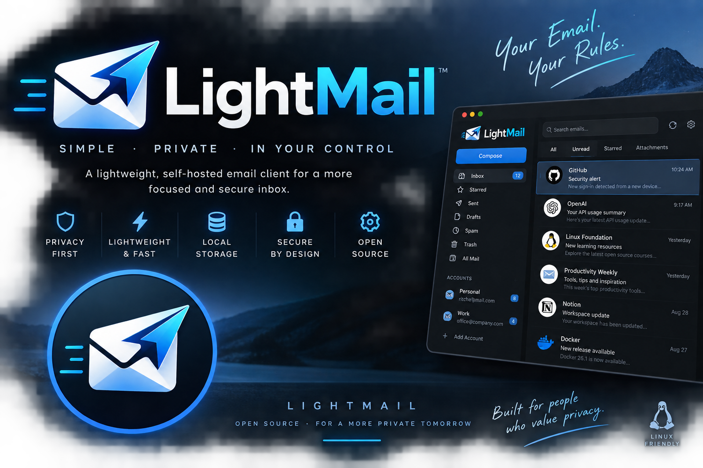

# LightMail



Lightweight local email client. Express + SQLite backend, vanilla-JS (ES modules, no build step) SPA frontend, IMAP sync (ImapFlow) + SMTP send (nodemailer).

Author: Ritche Gerona

## Features

- **Server** — Express API with security headers (CSP, HSTS, X-Frame-Options), rate limiting (300 req/min per IP), CSRF double-submit cookie protection, and AES-256-GCM encryption for stored passwords.
- **IMAP sync** — INBOX, Sent, Drafts (newest 50 each) via ImapFlow, storing both text/plain and text/html bodies plus attachment metadata for on-demand download.
- **SMTP send** — nodemailer with STARTTLS/SSL support, attachments, CC/BCC.
- **Attachments** — upload (multer, 25 MB cap) with stale-file sweep; on-demand download from IMAP.
- **Background sync** — auto-sync every 60s.
- **Frontend** — no build step, ES modules. Sidebar with accounts/folders, email list with pagination and bulk actions (read/unread/star/delete), HTML-email sandbox rendering (remote images blocked until allowed), draft saver with minimize-to-pill composer, keyboard shortcuts, and light/dark/system themes.

## Prerequisites

- Node.js 20
- A Gmail account (or other IMAP/SMTP server) — Gmail requires a **16-character App Password**; regular passwords are rejected.

## Setup

1. Install dependencies:

   ```bash
   npm install
   ```

2. Create a `.env` file in the project root:

   ```bash
   ENCRYPTION_KEY=<64 hex chars>   # required — server exits if missing
   PORT=3000                      # optional, default 3000
   HOST=127.0.0.1                 # optional, default 127.0.0.1 (loopback-only)
   ```

   Generate a key with:

   ```bash
   node -e "console.log(require('crypto').randomBytes(32).toString('hex'))"
   ```

3. Start the server:

   ```bash
   npm run dev
   ```

4. Open http://127.0.0.1:3000 and add an account.

## Environment Variables

| Variable | Default | Description |
| --- | --- | --- |
| `ENCRYPTION_KEY` | — | **Required.** Exactly 64 hex chars. Server exits at require time without it. |
| `PORT` | `3000` | HTTP port. |
| `HOST` | `127.0.0.1` | Bind address. Deliberately loopback-only — the API has no auth. Set `0.0.0.0` only if LAN access is truly wanted. |
| `DB_PATH` | `data/mail.db` | Overrides the SQLite location. Tests rely on this. |
| `MAIL_ALLOW_INSECURE_TLS` | — | Set to `1` to re-enable old `rejectUnauthorized:false` behavior for self-signed IMAP/SMTP servers. Certificates are verified by default. |

## Commands

```bash
npm run dev    # start server (node server/index.js) on PORT 3000
npm start      # same but via nvm node 20 and kills anything on port 3000 first
npm test       # Jest + supertest (18 tests, <1s)
```

## Architecture

```
server/
  index.js      Express app + JSON API
  db.js         SQLite schema + migrations (promise wrappers)
  imap.js       ImapFlow sync + on-demand attachment download
  smtp.js       nodemailer send
  encryption.js AES-256-GCM (iv:tag:ciphertext hex)
public/
  index.html    Single-page shell (element IDs are load-bearing)
  style.css     Theming via [data-theme] tokens
  js/
    main.js     Wiring / boot
    mail.js     State, render, list/detail/folders/bulk/polling
    compose.js  Slide-over composer (CC/BCC, attachments, save-draft, minimize)
    keys.js     Keyboard shortcuts (j/k/Enter/r/f/c/e/s/,/?)
    theme.js    System/light/dark theming + localStorage
    ui.js, icons.js  SVG sprite icons
    api.js      Fetch wrappers
test/
  api.test.js   Jest + supertest suite
```

### API Routes

- `/api/accounts` — CRUD, plus `/unread` counts and `/:id/trash`
- `PATCH /api/accounts/:id/password` — update account password
- `/api/emails` — list, plus `/:id/read|flag|delete`, `DELETE /:id` (permanent), `/:id/attachments[/:attId]` (streaming from IMAP)
- `/api/drafts` — draft create/update/send-deletes-draft
- `/api/upload` — multer → `$TMPDIR/lightmail-uploads` (25 MB cap, stale-file sweep)
- `/api/send` — SMTP send (validates attachment paths stay inside the uploads dir)
- `/api/sync/:id` — trigger sync for an account

### Data Storage

- SQLite (`data/mail.db`) with `accounts`, `mailboxes`, `emails`, `attachments` tables.
- Unique indexes prevent duplicate emails/mailboxes; sent-mail dedup repoints rows via `rfc_message_id`.
- Passwords encrypted at rest with AES-256-GCM.

## Security Notes

- The server binds loopback-only by default — the API has **no authentication**. Do not expose it to a network without adding auth.
- HTML mail renders in a sandboxed iframe (`allow-same-origin`, **no** `allow-scripts`) with an injected CSP blocking remote images until "Load images" is clicked.
- Do not commit or delete `data/mail.db` — it contains live encrypted credentials.

## Testing

```bash
npm test
```

Tests mock `../server/imap` and `../server/smtp` (no network) and run against a throwaway `test/test_mail.db` (`DB_PATH`). Run a subset with `npx jest -t 'Drafts API'`. The frontend has no automated tests — verify UI changes by booting the server and exercising the SPA manually.

Live IMAP/SMTP verification requires a real account in `data/mail.db`; Gmail requires a 16-char App Password.

## License

Unlicensed / private.
